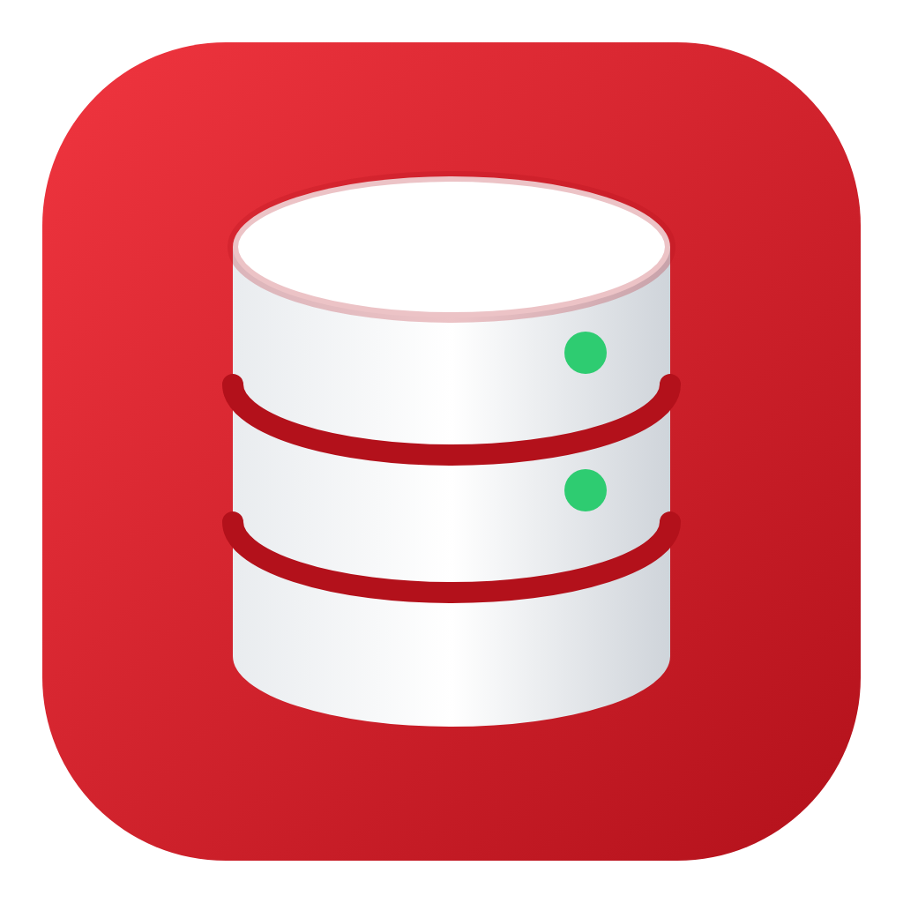
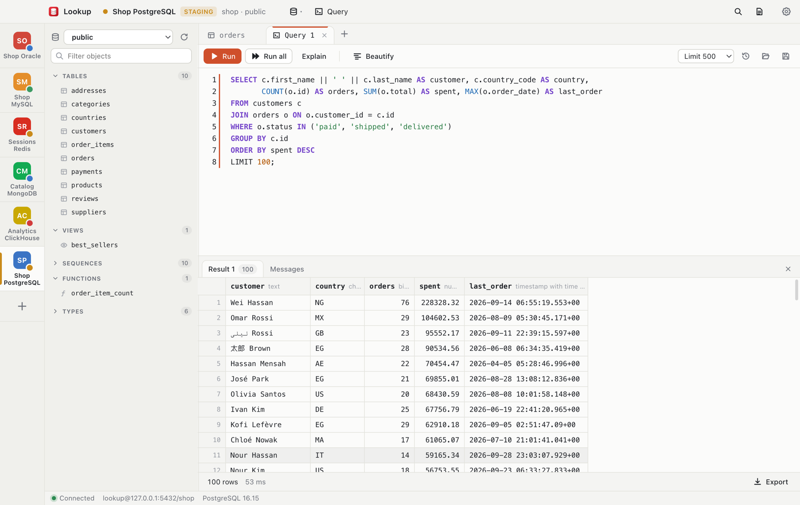

<h1>&nbsp;Lookup</h1>

One desktop app for Oracle, PostgreSQL, MySQL / MariaDB, SQLite, ClickHouse, Redis and MongoDB.  
No client software to install.



A fast desktop client for **Oracle**, **PostgreSQL**, **MySQL / MariaDB**, **SQLite**, **ClickHouse**, **Redis** and **MongoDB**: connection manager, schema browser, data grid, structure/DDL views and a SQL editor — for Redis, a key browser, key editors, a Workbench and a redis-cli Shell, and for MongoDB, a Compass-like collection view with a light mongosh-style shell.

Built with **Electron**. Every database is reached with a pure-JavaScript driver (node-oracledb in Thin mode, node-postgres, mysql2, the official ClickHouse and MongoDB drivers), the SQLite built into Electron itself, or, for Redis, Lookup's own small Redis protocol client, so there is **no client software to install** (no redis-cli or mongosh either).

## Contents

- [Highlights](#highlights)
- [Supported databases](#supported-databases)
- [Screenshots](#screenshots)
- [Installation](#installation)
- [Your first connection](#your-first-connection)
- [Features](#features): [Connections](#connections) · [Several databases at once](#several-databases-at-once) · [Lost connections](#lost-connections) · [Other databases on the same server](#other-databases-on-the-same-server) · [Redis](#redis) · [MongoDB](#mongodb) · [SQL log](#sql-log) · [Browser](#browser) · [Data grid](#data-grid) · [Export](#export) · [New table](#new-table) · [Structure & DDL](#structure--ddl) · [SQL editor](#sql-editor)
- [Shortcuts](#shortcuts)
- [Memory](#memory)
- [Development](#development)
- [Project layout](#project-layout)


## Highlights

- **Seven databases, one app**: Oracle, PostgreSQL, MySQL / MariaDB, SQLite, ClickHouse, Redis and MongoDB, with nothing else to install
- **Several connections open at once**, each with its own sidebar, tabs, results and transaction
- **Data grid**: paging on the server, filters, sorting, inline edits that stay pending until you preview the SQL or commit
- **SQL editor**: highlighting, autocomplete, Beautify, Explain, a row limit, and Stop for a running query
- **Export** to CSV, Excel, JSON or SQL `INSERT`, streamed so millions of rows don't freeze the app
- **Redis**: key browser, editors for every key type, Workbench, a Shell that prints like redis-cli, Overview, Redis Cluster
- **MongoDB**: documents, aggregation pipelines with live previews, schema, indexes, validation and a mongosh-style shell
- **Careful with your data**: manual commit by default, Production connections ask before changes, read-only connections, passwords encrypted with the operating system's keychain
- **Light on memory**, with light and dark themes (see [Memory](#memory))


## Supported databases


|                                                             | Oracle       | PostgreSQL         | MySQL / MariaDB               | SQLite                             | ClickHouse                    |
| ----------------------------------------------------------- | ------------ | ------------------ | ----------------------------- | ---------------------------------- | ----------------------------- |
| Connect, Test, Stop, Reconnect, lost-connection detection   | ✓            | ✓                  | ✓                             | ✓ (a file)                         | ✓ (HTTP/S)                    |
| Browse objects, Structure, DDL                              | ✓            | ✓                  | ✓                             | ✓                                  | ✓                             |
| Table data with paging, filters, sorting, count; export     | ✓            | ✓                  | ✓                             | ✓                                  | ✓                             |
| Query tabs: row limit, Explain, Beautify                    | ✓            | ✓                  | ✓                             | ✓                                  | ✓                             |
| Transactions (manual commit, Ctrl+S)                        | ✓            | ✓                  | ✓                             | ✓                                  | — none in ClickHouse          |
| Edit rows in the grid (add, change, delete; Ctrl+S commits) | ✓ (by ROWID) | ✓ (by primary key) | ✓ (by primary key)            | ✓ (by primary key)                 | — (analytics; use SQL)        |
| Create / alter / truncate / drop tables                     | ✓            | later              | later                         | later                              | —                             |
| Databases menu (database ▾)                                 | PDBs         | databases          | — (databases are the schemas) | — (attached files are the schemas) | — (databases are the schemas) |


Redis and MongoDB aren't SQL, so each gets its own workspace (see **Redis** and **MongoDB** below).

## Screenshots

Screenshots of the running app, taken against the sample databases in [test/docker](test/docker/CONNECTIONS.md), are in [docs/screenshots](docs/screenshots/).

## Installation


### Download

Get the latest build from the **[latest release](https://github.com/AliiMahmoud/Lookup/releases/latest)** page:

| Platform                      | File                                 |
| ----------------------------- | ------------------------------------ |
| Windows (installer)           | `Lookup.Setup.<version>.exe`         |
| Windows (portable, no install) | `Lookup-<version>-win.-.portable.zip` |
| macOS (Apple Silicon)         | `Lookup-<version>-arm64.dmg`         |
| macOS (Intel)                 | `Lookup-<version>.dmg`               |

The builds are not code-signed. On Windows, SmartScreen asks before the first run ("More info" → "Run anyway"). On macOS, if the app is reported as damaged or from an unidentified developer, right-click it in Applications and choose **Open**, or run `xattr -cr /Applications/Lookup.app`.

To run from source or build it yourself instead, read on.


### Requirements

- **Node.js 20 or later** (it comes with npm) and **Git**
- Windows, macOS or Linux
- Nothing else: no Oracle Instant Client, `psql`, `mysql`, `redis-cli` or `mongosh`


### Run from source

```bash
git clone <repository-url>
cd <repository-folder>
npm install
npm start
```

`npm install` downloads Electron and the database drivers (about 500 MB in `node_modules`). `npm start` opens the app; your connections, history and settings are kept in your user profile, not in the project folder.

If `npm start` fails with `Cannot read properties of undefined (reading 'isPackaged')`, the terminal has `ELECTRON_RUN_AS_NODE` set (some editor terminals do). Start it with `env -u ELECTRON_RUN_AS_NODE npm start` instead.

### Build a Windows installer or portable .exe

On a Windows machine, in the project folder:

```bash
npm install
npm run dist:win        # installer            -> dist/Lookup Setup <version>.exe
npm run dist:portable   # single portable .exe -> dist/Lookup-<version>-portable.exe
npm run dist:zip        # zipped app folder
```

The builds are 64-bit and not code-signed, so Windows SmartScreen asks before the first run ("More info" → "Run anyway").

### Portable mode

`npm run dist:portable` builds `dist/Lookup-<version>-portable.exe`, a single file that needs no installation.

In portable mode, connections, history and settings are kept in a `Lookup-data` folder **next to the .exe** instead of `%APPDATA%`. Portable mode is on automatically for the portable .exe, and for an unzipped folder build when a file named `portable` sits next to `Lookup.exe`.

Saved passwords are still encrypted with the Windows account that saved them, so on another PC the connections carry over but you re-enter the passwords.

### macOS and Linux

macOS builds are on the [latest release](https://github.com/AliiMahmoud/Lookup/releases/latest) page (see [Download](#download)). On Linux, run from source as above; no packaged Linux build is set up yet.

### Sample databases to try it with (optional)

The repository has a Docker setup with Oracle, PostgreSQL, MySQL, ClickHouse, Redis and MongoDB, all filled with the same sample shop data (the screenshots above use it):

```bash
docker compose -f test/docker/docker-compose.yml up -d
```

Then, on Lookup's home screen, choose **Import**, pick `test/docker/lookup-connections.xml` and enter the file password `lookup`. [test/docker/CONNECTIONS.md](test/docker/CONNECTIONS.md) lists the connections and the data.

## Your first connection

1. Click **+ New** on the home screen and pick the database.
2. Fill in the form (host, port, user, password; for SQLite, a file). Choose a tag: **Production** makes Lookup ask before anything that changes data.
3. Click **Test** to check it, then **Connect**. The connection is saved in the list on the left; double-click it next time.

Open more databases with the `+` in the left rail (`Ctrl+N`); each one keeps its own tabs and transaction.

## Features


### Connections

- One form per database, as fields or a URL, with **Test** before you connect
- Colour tags (Local / Dev / Staging / Production); Production asks before anything that changes data
- Passwords encrypted with the operating system's keychain, never stored as plain text
- Import and export in Oracle SQL Developer format, with passwords sealed by a file password if you want them included


### Several databases at once

- Every open connection is a tile in the left rail, with its own sidebar, tabs and transaction
- Click to switch, drag to reorder, `Ctrl+Alt+1…9` to jump
- Opening a database that is already open switches to it instead of starting a second session


### Lost connections

- Connecting can be cancelled, and gives up after a timeout you set
- A dropped connection turns the status bar red; **Reconnect** (`Ctrl+R`) starts a fresh session
- **Stop** sends one cancel request and never retries, so the database gets no extra load


### Other databases on the same server

- The database button in the title bar lists the server's Oracle PDBs or PostgreSQL databases; pick one to open it with the same login


### Redis

- **Key browser**: folders at `:`, type chips, and a filter searched in Redis itself with `SCAN` (never `KEYS`)
- **Key tabs** for strings, hashes, lists, sets, sorted sets, streams and JSON; edits are saved together in `MULTI` / `EXEC`
- **Workbench** with formatted replies, and a **Shell** that prints exactly like redis-cli
- **Delete keys** by pattern: counts first, asks with the exact number, then deletes in batches
- **Overview**: commands per second, memory, clients, slow log
- **Redis Cluster** is detected by itself


### MongoDB

- **Documents**: filter, project and sort in mongosh syntax; List, JSON or Table view; an edit sends only the fields you changed
- **Aggregations**: stages as cards, each with a live preview of its output
- **Schema**, **Indexes** and **Validation** for every collection
- **Shell** with mongosh-style commands (no JavaScript), and an **Overview** of the server


### SQL log

- Every statement Lookup runs by itself (`Ctrl+Shift+L`), with bind values, duration and row counts; your own queries stay in Query history


### Browser

- Tables, views, sequences, packages, procedures, functions, triggers and more, with a filter
- `Ctrl+P` jumps to any object


### Data grid

- Paging on the server, click a header to sort, filter by column or a raw `WHERE`
- Edit, add and delete rows: changes stay pending (yellow / green / red) until you **Preview SQL** or **Commit** (`Ctrl+S`), and roll back together on error
- Row details panel, copy as tab-separated cells, smooth scrolling on large pages


### Export

- CSV, Excel, JSON or SQL `INSERT`, from a whole table, the current page, selected rows or a query result
- Streamed in batches, so millions of rows don't freeze the app


### New table

- A quick table editor for Oracle: name, columns, primary key, and **Preview SQL** before you create


### Structure & DDL

- Columns, constraints and indexes at a glance; on Oracle, change them and apply with `Ctrl+S`
- Full DDL to copy, save as `.sql` or open in the editor


### SQL editor

- Highlighting, autocomplete, **Beautify** (`Ctrl+B`), Explain and Stop
- `Ctrl+Enter` runs the statement under the cursor, `Ctrl+Shift+Enter` runs the whole script
- Manual commit by default: `Ctrl+S` commits, and the status bar shows when a transaction is open
- Results stop at 500 rows unless you raise the limit; history and tabs come back per connection
- **Persisted Queries** (title bar, next to Query): one query tab per connection, saved as you type; close it or quit and it opens again exactly as you left it


## Shortcuts

On a Mac, `⌘` works in place of `Ctrl`.


| Keys                              | Action                           |
| --------------------------------- | -------------------------------- |
| `Ctrl+N`                          | Open a connection                |
| `Ctrl+E` or `Ctrl+T` / `Ctrl+W`   | New query tab / close tab        |
| `Ctrl+P`                          | Open anything                    |
| `Ctrl+Enter` / `Ctrl+Shift+Enter` | Run statement / run all          |
| `Ctrl+B`                          | Beautify SQL                     |
| `Ctrl+S`                          | Commit, or apply pending changes |
| `Ctrl+Shift+E`                    | Export                           |
| `Ctrl+R`                          | Reconnect                        |
| `Ctrl+Shift+L`                    | Show / hide the SQL log          |
| `Ctrl+F` / `F5`                   | Filter / refresh a table         |
| `Ctrl+Z` / `Ctrl+Y`               | Undo / redo grid changes         |
| `Ctrl+D`                          | Duplicate the row in a table     |
| `Ctrl+=` / `Ctrl+-` / `Ctrl+0`    | Zoom in / out / reset            |
| `Ctrl+Alt+→` / `Ctrl+Alt+←`       | Next / previous connection       |


## Development

Plain JavaScript with no build step: edit a file and restart the app.

```bash
npm test                          # unit tests, plus engine tests against real servers (skipped when none answers)
npx electron test/smoke-tour.js   # boots the real app with a simulated database and visits most screens
npx electron test/bench.js        # memory benchmark
```


## Project layout

```
src/main/        Electron main process: windows, menus, settings
src/main/db/     database access, one folder per database
src/renderer/    the interface, one feature per file
src/shared/      code both sides use: SQL splitter, Redis and MongoDB shell helpers
test/            unit tests, smoke tests, memory benchmark, Docker sample databases
```

